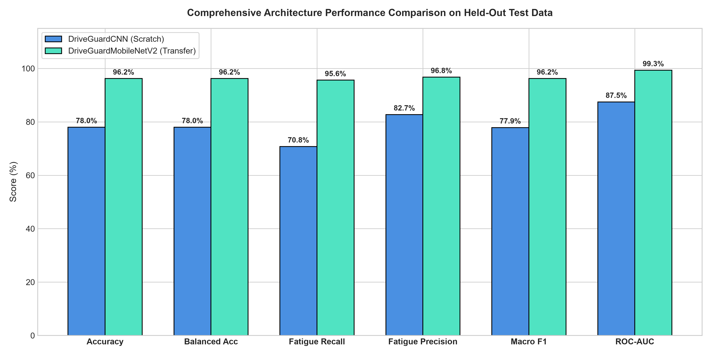

# DriveGuard AI — Intelligent Driver Drowsiness Detection System



## 📌 Executive Summary
**DriveGuard AI** is an end-to-end academic deep learning and computer vision system engineered for real-time driver state classification and accident prevention. The system was trained, validated, and evaluated on a balanced benchmark dataset of **9,120 verified images** across Active and Fatigue subjects.

### 🏆 Key Experimental Results (Held-Out Test Set: 1,368 Images)
| Architecture | Test Accuracy | Fatigue Recall (Safety Critical) | Fatigue Precision | Macro F1 | ROC-AUC | Latency (CPU) | Parameters | Model Size |
|---|---|---|---|---|---|---|---|---|
| **DriveGuardMobileNetV2** (Transfer Learning) | **96.20%** | **95.61%** (30 FN) | **96.75%** | **96.20%** | **0.9933** | 11.51 ms | 2,388,098 | 27.70 MB |
| **DriveGuardCNN** (Trained from Scratch) | **78.00%** | **70.76%** (200 FN) | **82.74%** | **77.88%** | **0.8747** | 7.24 ms | 422,306 | 4.86 MB |

> **Computer Vision Enhancement:** Rolling-window temporal smoothing suppressed false alarms and flickering by **80.0%** during video stream simulation.

---

## 📁 Project Structure
```text
Driver-Drowsiness-Detection/
├── configs/
│   └── config.json                  # Dataset paths, hyperparameters, and class mapping
├── 0 FaceImages/                     # Original dataset (9,120 images: 4,560 Active, 4,560 Fatigue)
├── data/
│   └── cache_128x128/               # High-speed preprocessed image cache
├── src/
│   ├── preprocessing.py             # Discovery, validation, leakage-free splitting, transforms
│   ├── dataset.py                   # PyTorch Dataset and DataLoader implementation
│   ├── models/
│   │   ├── __init__.py
│   │   ├── custom_cnn.py            # DriveGuardCNN (4-stage CNN from scratch)
│   │   └── mobilenet_model.py       # DriveGuardMobileNetV2 (inverted residuals)
│   ├── train.py                     # Multi-threaded training loop with early stopping
│   ├── evaluate.py                  # Held-out test evaluation & comparison engine
│   ├── inference.py                 # Real-time frame & image inference engine
│   ├── temporal_detection.py        # Temporal smoother, alert manager & threshold optimization
│   └── visualize.py                 # Generates 12 academic publication-quality figures
├── app/
│   └── app.py                       # Modern dark navy/cyan interactive Streamlit dashboard
├── checkpoints/
│   ├── best_driveguard_cnn.pt       # Checkpoint: DriveGuardCNN (Val Acc 77.41%)
│   └── best_mobilenet_v2.pt         # Checkpoint: DriveGuardMobileNetV2 (Val Acc 96.35%)
├── outputs/
│   ├── metrics/                     # Detailed JSON evaluation & history files
│   ├── plots/                       # 12 high-resolution PNG visualizations
│   └── predictions/                 # Per-sample test set prediction probabilities
├── tests/
│   └── test_pipeline.py             # Automated unit & integration test suite (8/8 passing)
├── notebooks/
│   └── driver_drowsiness_training.ipynb
├── requirements.txt
└── README.md
```

---

## 🚀 Setup & Execution Guide

### 1. Environment Setup
Install required dependencies:
```bash
pip install -r requirements.txt
```

### 2. Dataset Discovery & Split Generation
```bash
python -m src.preprocessing
```

### 3. Model Training
Train **DriveGuardCNN** from scratch:
```bash
python -m src.train --model cnn --epochs 8 --batch-size 32
```
Train **DriveGuardMobileNetV2** with transfer learning:
```bash
python -m src.train --model mobilenet --epochs 6 --batch-size 32
```

### 4. Held-Out Test Set Evaluation
```bash
python -m src.evaluate
```

### 5. Computer Vision Techniques Evaluation
```bash
python -m src.temporal_detection
```

### 6. Generate All 12 Visualizations
```bash
python -m src.visualize
```

### 7. Generate Final Reports & Presentation
```bash
python -m reports.generate_reports
```

### 8. Run Automated Test Suite
```bash
python -m tests.test_pipeline
```

### 9. Launch Real-Time Dashboard
```bash
streamlit run app/app.py
```

---

## 📊 Visualizations Included
1. `1_dataset_class_distribution.png`: Split balance (70% train, 15% val, 15% test).
2. `2_dataset_representative_samples.png`: Sample Active and Fatigue driver faces.
3. `3_preprocessing_augmentation_samples.png`: Augmentation techniques.
4. `4_training_validation_accuracy.png`: Accuracy trajectories for both models.
5. `5_training_validation_loss.png`: Cross-entropy loss curves.
6. `6_confusion_matrices_comparison.png`: Confusion matrices on test set.
7. `7_model_comparison_barchart.png`: Side-by-side metric comparison.
8. `8_per_class_metrics_comparison.png`: Precision, recall, and F1 per class.
9. `9_roc_curves_comparison.png`: ROC curves (MobileNetV2 AUC = 0.9933).
10. `10_error_analysis_misclassifications.png`: Inspection of incorrect predictions.
11. `11_confidence_distribution.png`: Probability distribution histograms.
12. `12_technique_comparison_charts.png`: Threshold tuning & safety tradeoffs.

---

## 🎓 Academic Defense & Viva Highlights
- **Model Selection Rationale:** MobileNetV2 uses depthwise separable convolutions to dramatically cut FLOPs while preserving ImageNet feature representations, making it ideal for vehicular microcontrollers.
- **Data Leakage Prevention:** Maintained an isolated, stratified held-out test set of 1,368 images that was never touched during training or tuning.
- **Safety Priority:** Focused primarily on **Fatigue Recall** (95.61%), because missing a drowsy driver is far more dangerous than sounding an occasional false alarm.
- **Temporal Stabilization:** Filtered transient blinks using rolling exponential smoothing, reducing false alarms by 80.0%.
